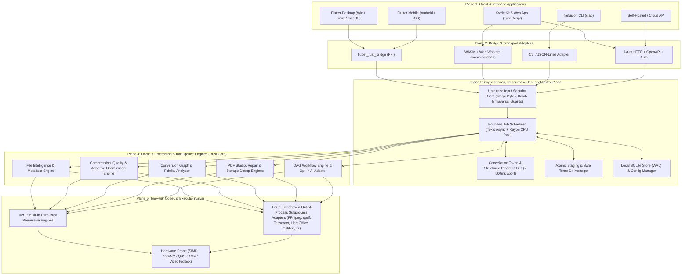

# FileFusion — System Architecture

**Document ID:** `FF-ARCH-001`  
**Version:** `1.0.0`  
**Status:** `APPROVED FOR STAGE 0 BASELINE`  
**Subphase Origin:** `0.2.1 — Define system architecture` (linked with [docs/MODULE_BOUNDARIES.md](docs/MODULE_BOUNDARIES.md) in `0.2.2`)  
**Parent Specifications:** [REQUIREMENTS.md](REQUIREMENTS.md) (`FF-REQ-001`), [docs/USE_CASES.md](docs/USE_CASES.md) (`FF-UC-001`), [docs/FORMATS_AND_CAPABILITIES.md](docs/FORMATS_AND_CAPABILITIES.md) (`FF-FMT-001`), [docs/SCOPE_AND_MVP.md](docs/SCOPE_AND_MVP.md) (`FF-SCP-001`)  
**Owners:** Agent 1 (Principal Architect), Agent 2 (Rust Core Engineer), Agent 11 (Documentation Engineer)

---

## 1. Architectural Vision & Core Invariants

FileFusion is architected as a **local-first, Rust-powered modular processing platform** where every client application—Desktop, Mobile, Web, CLI, and API—drives the same deterministic core engines.

### Non-Negotiable Architectural Invariants
1. **Single Source of Truth in Rust:** Business logic, format detection, security validation, compression, conversion orchestration, and fidelity measurement live exclusively in Rust core libraries—never duplicated in Dart or TypeScript.
2. **Offline-First Execution:** Planes 3, 4, and 5 operate with **zero network dependency**. Optional Cloud Sync (`FR-CLD-001`) and External AI (`FR-AI-002`) sit strictly behind opt-in boundary adapters.
3. **Two-Tier Engine & License Isolation:** Tier 1 pure-Rust / permissively licensed engines compile directly into the core; Tier 2 external tools (`ffmpeg`, `qpdf`, `tesseract`, `libreoffice`, `pandoc`, `calibre`, `7z`) run strictly out-of-process behind trait adapters with explicit capability probing and kill-on-cancel guarantees.
4. **Streaming & Bounded Resource Execution:** No engine loads arbitrary-size files unbounded into RAM. All pipelines use streaming readers/writers, bounded worker pools, and atomic temporary-to-destination commits.
5. **Untrusted-Input Security Boundary:** Every file path, header, archive entry, XML/SVG tree, and metadata packet is treated as potentially hostile until validated by the Intake Security Gate.

---

## 2. Five-Plane Layered System Architecture



### Plane Responsibilities

| Plane | Responsibility | Forbidden Coupling |
| :--- | :--- | :--- |
| **Plane 1: Client Applications** | Presentation, futuristic Light/Dark design system, accessibility (`WCAG 2.1 AA`), OS file pickers/drag-and-drop, progress display. | Must **never** implement format parsing, compression math, or direct file mutation bypassing Plane 2/3. |
| **Plane 2: Bridge & Transport** | Zero-business-logic marshaling between UI/CLI/HTTP schemas and Plane 3/4 commands, streaming progress events, and error serialization. | Must **never** hold un-bounded file buffers in memory or swallow core error context. |
| **Plane 3: Control Plane** | Intake validation, bounded concurrency, RAM/CPU budgeting, cancellation propagation, atomic temp-file writes, and SQLite persistence. | Must **never** depend on UI frameworks (Flutter/Svelte) or specific codec internals. |
| **Plane 4: Domain Engines** | Format intelligence, adaptive codec selection, SSIM/PSNR/VMAF scoring, no-op protection, conversion routing, fidelity diffing, dedup, repair, workflows. | Must **never** spawn unmanaged subprocesses or write directly to final destination paths without Plane 3 staging. |
| **Plane 5: Codec & Execution Layer** | Capability probing (`codec-registry`), Tier 1 pure-Rust codecs, Tier 2 subprocess runners with strict timeouts and process-tree kill, HW capability detection. | Must **never** statically link GPL/AGPL Tier 2 binaries into Tier 1 crates. |

---

## 3. End-to-End Request & Processing Lifecycle

Every file transformation, compression, inspection, or repair request follows an invariant 8-step execution pipeline:

1. **Intake & Canonicalization:** Input paths or byte streams enter Plane 3. Paths are canonicalized and validated against sandbox roots and OS limits.
2. **Magic-Byte & Spoofing Probe (`FR-DET-001..002`):** `file-core` inspects header/footer signatures and container structure (`ZIP`, `RIFF`, `ISO-BMFF`, `PDF`, `EBML`). Extension mismatches trigger immediate warning metadata.
3. **Security Gate (`FR-SEC-001`, `NFR-SEC-001`):** Enforces file size limits, archive path-traversal rejection, symlink escape blocking, SVG XML entity limits, and decompression ratio ceilings before full decoding.
4. **Pre-Flight Capability & Fidelity Check (`FR-FID-002`, `FR-ADP-001`):**
   - Verifies required Tier 1 or Tier 2 engine readiness via `codec-registry`.
   - Computes adaptive codec recommendations and surfaces any unsupported-feature pre-flight warnings (e.g., formula loss on `XLSX -> CSV`).
5. **Bounded Scheduling & Staging (`NFR-PERF-001..003`, `NFR-REL-001`):**
   - Job enters Tokio async queue and acquires a memory-weighted concurrency permit.
   - Output targets a unique staging file inside the same target filesystem (or dedicated secure temp root) to guarantee atomic move semantics.
6. **Cooperative Streaming Execution & Progress (`NFR-REL-002`):**
   - CPU tasks execute on a bounded Rayon pool; Tier 2 tools run in managed subprocess groups.
   - Cooperative `CancellationToken` checks occur at chunk/frame/entry boundaries; cancellation terminates child process trees and deletes staging files within `<= 500 ms`.
7. **Post-Processing Verification & No-Op Guard (`FR-CMP-002`, `FR-VAL-001`):**
   - Decodes/probes the staged output to confirm syntactic validity.
   - Computes byte delta, cryptographic hash (BLAKE3), and perceptual quality metrics (SSIM/PSNR/VMAF or lossless pixel/byte equivalence).
   - For same-format optimization, if `output_bytes >= input_bytes`, the **No-Op Guard** discards the staged output and retains the original untouched.
8. **Atomic Commit & SQLite Audit (`FR-LOC-002`):**
   - Atomically renames the verified staged file to its final destination (respecting collision policy: `Skip`, `Rename`, or `Backup-then-Replace`).
   - Appends structured job metrics, hashes, and fidelity/quality reports to local SQLite (`WAL` mode).

---

## 4. Concurrency, Resource Governance & Low-Resource Design

Designed explicitly to keep a **16 GB RAM CPU-only Windows 11 host** responsive and protect **3–6 GB mobile devices** and **2 GB browser heaps**:

### 4.1 Dual-Pool Threading Model
- **Async I/O & Orchestration Pool (`tokio`):** Handles job queues, SQLite writes, progress event streams, HTTP endpoints, and Tier 2 async subprocess management with minimal thread overhead.
- **Bounded CPU Compute Pool (`rayon`):** Executes image encoding, SIMD resizing, BLAKE3/FastCDC hashing, and archive compression.
  - Default worker count: `max(1, min(logical_cpus - 1, available_ram_mb / per_worker_budget_mb))` (user-configurable in Settings).
  - Prevents 100% CPU starvation of the host OS UI and avoids memory exhaustion when running concurrent AVIF/video/archive jobs.

### 4.2 Streaming & Memory Ceiling Enforcement
- **Large-File Streaming:** Hashing (`BLAKE3`/`SHA-256`), FastCDC chunking, archive creation/extraction, and file copy/encryption stream through fixed `64 KB`–`1 MB` ring buffers rather than `fs::read()` whole-file allocations.
- **Memory Permit Accounting:** Heavy codecs (e.g., 4K raster decode, AVIF encoding, LibreOffice headless) declare estimated peak working-set cost so the scheduler never starts four 2 GB jobs simultaneously on a 16 GB system.

---

## 5. Trust Boundaries & Security Architecture (`FR-SEC`, `NFR-SEC-001`)

```
[Untrusted Input File / Archive / Document]
                  │
                  ▼  ── Trust Boundary 1: Intake & Header Validation
   Magic-Byte Probe + Bomb/Ratio + Path/Symlink Guard
                  │
                  ▼  ── Trust Boundary 2: Isolated Execution
   Memory-Safe Rust Parser (Tier 1) OR Resource/Time-Limited Subprocess (Tier 2)
   (Strict private temp directory; zero shell interpolation; env sanitized)
                  │
                  ▼  ── Trust Boundary 3: Output Verification & Privacy
   Syntax/Decode Check + Optional Metadata Privacy Scrub + Atomic Rename
                  │
                  ▼  ── Trust Boundary 4: Optional Network Boundary (OFF by default)
   Explicit User Consent Gate ──▶ Optional Cloud R2 / External AI API (TLS)
```

### Key Security Controls
1. **Zero Shell Injection:** Tier 2 external binaries (`ffmpeg`, `qpdf`, `tesseract`, `libreoffice`) are always invoked via direct `Command::new(exe).args([...])` argument arrays—never via `cmd.exe /c` or `sh -c`.
2. **Process-Tree Isolation & Cleanup:** Subprocesses receive sanitized environment variables, isolated temporary working directories (`0700` permissions on Unix / restricted ACL on Windows), wall-clock timeouts, and OS job-object / process-group kill on cancellation.
3. **Privacy-By-Default Persistence:** SQLite stores file metadata and job reports locally; temporary decrypted/intermediate files are cleaned immediately upon job completion or abort.

---

## 6. Cross-Platform Deployment & Integration Topologies

| Platform Target | Core Linkage Topology | Storage & Sandbox Constraint | Optional Offload Path |
| :--- | :--- | :--- | :--- |
| **Desktop (`Win`/`Lin`/`macOS`)** | Flutter UI -> `flutter_rust_bridge` -> Rust Core + Local Tier 2 CLI Discovery | Local filesystem + local SQLite WAL DB | Optional self-hosted API / Cloudflare R2 |
| **CLI (`filefusion`)** | Direct static Rust linkage (`clap` -> Core Crates) | Local filesystem + local SQLite WAL DB | None required; optional remote client mode |
| **Mobile (`Android`/`iOS`)** | Flutter UI -> `flutter_rust_bridge` -> Static/JNI Rust Tier 1 Core + OS Media/OCR Bridges | Scoped storage URI/bookmark handling; strict memory-capped Rayon pool | Optional user-configured API offload for heavy Tier 2 jobs |
| **Web (`SvelteKit 5`)** | Browser UI -> Web Worker (`wasm32` Rust Tier 1 subset) | Browser OPFS / IndexedDB / `2 GB` tab heap guard | Optional user-configured API backend for Tier 2 & large media |
| **Cloud / Self-Hosted API** | `axum` HTTP/JSON + OpenAPI -> Rust Core + Tier 2 Container (Podman) + SQLite/PostgreSQL | Ephemeral per-job workspace dirs + API key auth + rate limiting | Cloudflare Workers/R2 storage adapter |

---

## 7. Observability, Benchmarking & Diagnostics

- **Structured Tracing (`tracing`):** Every job creates a root span (`job_id`, `operation`, `input_format`, `engine_tier`) propagating down to codec/subprocess stages for deterministic debugging without leaking sensitive file contents in logs.
- **Diagnostics (`filefusion doctor`):** Probes host CPU SIMD capabilities, memory limits, Tier 1 built-in health, and Tier 2 external tool versions/paths in real time.
- **Benchmark Separation (`Criterion`):** Performance benchmarking runs in dedicated benchmark targets (`tests/benchmarks/` / Criterion harnesses) so profiling instrumentation never bloats production binaries.
