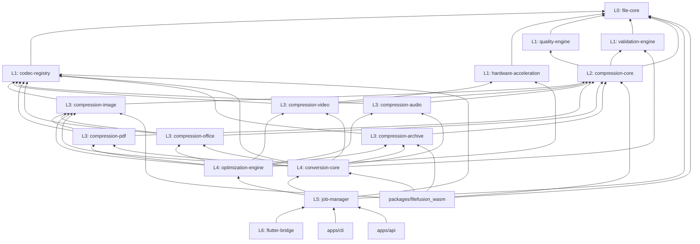

# FileFusion — Monorepo Module Boundaries & Dependency DAG

**Document ID:** `FF-MOD-001`  
**Version:** `1.0.0`  
**Status:** `APPROVED FOR STAGE 0 BASELINE`  
**Subphase Origin:** `0.2.2 — Define module boundaries`  
**Parent Specification:** [ARCHITECTURE.md](../ARCHITECTURE.md) (`FF-ARCH-001`)  
**Owners:** Agent 1 (Principal Architect), Agent 2 (Rust Core Engineer)

---

## 1. Purpose & Boundary Governance

This specification defines the exact **module boundaries, monorepo directory ownership, Rust workspace crate dependency DAG, feature-flag compilation targets (Desktop/CLI/Mobile/WASM), and forbidden coupling rules** for FileFusion.

### Core Module Principles
1. **Strict Acyclic Dependency Graph (DAG):** No circular crate dependencies are permitted anywhere in the workspace (`cargo metadata` / CI boundary checks enforce this).
2. **No Empty Decorative Modules:** Directories and crates are materialized only in the stage where they have real, tested implementations (`FF-SCP-001`).
3. **Thin Application Shells:** Applications under `apps/*` contain UI/CLI/HTTP transport glue only; all domain logic lives in `crates/*`.
4. **WASM & Mobile Portability via Feature Flags:** Lower-layer crates (`file-core`, `compression-core`, `compression-image`, `compression-archive`, `validation-engine`) isolate OS-specific process spawning and native SQLite behind Cargo features (`native-process`, `sqlite-store`, `wasm`).

---

## 2. Monorepo Directory Ownership Map

| Path | Category | Architectural Plane | Primary Responsibility | Primary Owner(s) |
| :--- | :--- | :--- | :--- | :--- |
| `crates/*` | Rust Core Workspace | Planes 2–5 | 16 modular Rust crates implementing detection, compression, conversion, quality, validation, scheduling, and FFI bridge | Agent 2, Agent 3, Agent 4 |
| `apps/cli/` | Application | Plane 1 / 2 | Native `filefusion` CLI (`clap`), TUI progress, `--json` output, `doctor` & `bench` commands | Agent 2 |
| `apps/desktop/` | Application | Plane 1 | Flutter Desktop shell for Windows, Linux, and macOS (windowing, drag-and-drop, native file dialogs) | Agent 5, Agent 7 |
| `apps/mobile/` | Application | Plane 1 | Flutter Mobile shell for Android and iOS/iPadOS (scoped storage, foreground tasks, share sheet) | Agent 5, Agent 7 |
| `apps/web/` | Application | Plane 1 | SvelteKit 5 + Svelte 5 + TypeScript responsive web app (`WCAG 2.1 AA`, WASM Worker + optional API) | Agent 6, Agent 7 |
| `apps/api/` | Application | Plane 1 / 2 | Self-hosted `axum` REST API server (Stage 10: OpenAPI, API keys, rate limiting, PostgreSQL/R2) | Agent 2, Agent 10 |
| `packages/` | Shared Libraries | Plane 1 / 2 | Shared Flutter Design System (`filefusion_ui`) and Web WASM bindings (`filefusion_wasm`) | Agent 5, Agent 6, Agent 7 |
| `infrastructure/` | Deployment | Ops | Podman containerfiles (< 30 GB budget), Cloudflare Workers/R2 manifests, self-hosting compose configs | Agent 10 |
| `scripts/` | Tooling | Ops | Local build scripts (`build.ps1`, `build.sh`), license/SBOM audit helpers | Agent 10 |
| `tests/` | Quality Suite | QA | Cross-crate integration, E2E, conversion fidelity, security/bomb corpus, and Criterion benchmarks | Agent 8, Agent 9 |
| `fixtures/` | Test Corpus | QA | Deterministic sample files (valid, edge-case, corrupt, malformed, bomb fixtures) | Agent 8, Agent 9 |
| `docs/` & Root `.md` | Governance | Docs | Authoritative specs, architecture, ADRs, progress, engineering contract, user/dev guides | Agent 11, Agent 1 |
| `.github/` | CI/CD | Ops | Selectable `build-apps.yml`, release automation, PR/issue templates | Agent 10 |
| `.agents/` | Antigravity | Governance | Project rules (`.agents/rules/`), reusable workflow skills, and 12 specialist agent `SKILL.md` files | Agent 1, Agent 11 |

---

## 3. Rust Workspace Crate Registry (`crates/*`)

The workspace comprises **16 core crates** organized into **7 strict acyclic dependency tiers (`L0`–`L6`)**:

| Tier | Crate Name | Path | Responsibility & Boundaries | Target Portability |
| :---: | :--- | :--- | :--- | :--- |
| **L0: Foundation** | `file-core` | `crates/file-core` | Canonical error types, configuration structs, magic-byte & container signature detection, MIME/format taxonomy, normalized metadata schema, BLAKE3/SHA-256/xxHash64 streaming hashers, security path/ratio primitives. **Zero codec or UI dependencies.** | Native + `wasm32` |
| **L1: Capabilities & Quality** | `codec-registry` | `crates/codec-registry` | Tier 1 built-in capability registry, Tier 2 external binary probe (`ffmpeg`, `qpdf`, `tesseract`, `libreoffice`, `pandoc`, `calibre`, `7z`), license & compliance metadata (`MIT`/`GPL`/etc.). | Native (`wasm32` Tier 1 subset) |
| **L1: Capabilities & Quality** | `hardware-acceleration` | `crates/hardware-acceleration` | CPU SIMD feature probe (AVX2/AVX-512/NEON) and optional GPU encoder discovery (NVENC, QSV, AMF, VideoToolbox, MediaCodec) with deterministic fallback flags. | Native (`wasm32` no-op stub) |
| **L1: Capabilities & Quality** | `quality-engine` | `crates/quality-engine` | SSIM, PSNR, pixel-exact RGB/RGBA diff, VMAF adapter, perceptual audio diff, and lossless bit-exact byte/stream verification. | Native + `wasm32` (image/byte metrics) |
| **L1: Capabilities & Quality** | `validation-engine` | `crates/validation-engine` | Post-processing output syntax/decoder validation, archive traversal & bomb-limit enforcement, SVG anti-XXE verification, and structured Validation/Fidelity Reports. | Native + `wasm32` |
| **L2: Compression Base** | `compression-core` | `crates/compression-core` | Shared compression traits, 5 standard profiles (`Lossless Maximum`..`Archival Cold`), **No-Op / inflation guard**, cancellation check helpers, and compression metric reports. | Native + `wasm32` |
| **L3: Format Engines** | `compression-image` | `crates/compression-image` | JPEG, PNG (`oxipng`), WebP, AVIF (`ravif`), TIFF, GIF, BMP, ICO, SVG rasterize/optimize, `fast_image_resize` SIMD scaling, EXIF auto-orient & privacy scrub. | Native + `wasm32` |
| **L3: Format Engines** | `compression-video` | `crates/compression-video` | Tier 2 FFmpeg video pipeline, H.264/HEVC/VP9/AV1 (`SVT-AV1`/`rav1e`/HW backends), fast-path remuxing, subtitle stream handling. | Native (`native-process`) |
| **L3: Format Engines** | `compression-audio` | `crates/compression-audio` | FLAC, WAV, ALAC, Opus, AAC, MP3, Vorbis decode/encode, audio track extraction, EBU R128 loudness normalization, ID3/Vorbis tag handling. | Native (`wasm32` WAV/FLAC subset) |
| **L3: Format Engines** | `compression-pdf` | `crates/compression-pdf` | PDF structural ops (merge, split, rotate, crop, watermark, AES-256 protect, signature check), embedded image/stream compression, Tier 2 `qpdf` & `tesseract` OCR orchestration, PDF repair. | Native + `wasm32` (Tier 1 structural) |
| **L3: Format Engines** | `compression-office` | `crates/compression-office` | OOXML (`DOCX`/`XLSX`/`PPTX`), ODF (`ODT`/`ODS`/`ODP`), and `EPUB` structural asset compression, XML/media optimization, and office metadata privacy scrub. | Native + `wasm32` |
| **L3: Format Engines** | `compression-archive` | `crates/compression-archive` | ZIP, TAR, Zstd, LZ4, Brotli, Gzip, XZ, Bzip2, 7z (`sevenz-rust` + Tier 2 `7z`), `.ffenc` (`AES-256-GCM`/`ChaCha20-Poly1305` + `Argon2id`), bomb-safe extraction, ZIP central-directory repair. | Native + `wasm32` |
| **L4: Intelligence & Routing** | `optimization-engine` | `crates/optimization-engine` | Content-aware adaptive codec recommender, quality-constrained CRF/quantizer binary solver, benchmark-driven preset tuning, duplicate/FastCDC/pHash storage analyzer. | Native + `wasm32` (subset) |
| **L4: Intelligence & Routing** | `conversion-core` | `crates/conversion-core` | Universal multi-hop conversion graph, direct-first/lossless-hub route selector, Markdown/HTML/CSV/JSON/YAML/EPUB/Office/Media conversion orchestration, Pre-Flight warnings, Fidelity Reports. | Native + `wasm32` (Tier 1 subset) |
| **L5: Control Plane** | `job-manager` | `crates/job-manager` | Bounded Tokio async + Rayon CPU scheduler, memory-permit accounting, 500 ms cancellation & process-tree cleanup, atomic temp-file staging, SQLite WAL persistence, batch naming templates, DAG workflow executor, opt-in AI adapter interface. | Native (`wasm32` single-job worker mode) |
| **L6: FFI Bridge** | `flutter-bridge` | `crates/flutter-bridge` | Thin `flutter_rust_bridge` API surface translating Dart calls/streams to `job-manager`, `file-core`, and `codec-registry`. Zero business logic. | Native FFI (`Win`/`Lin`/`macOS`/`Android`/`iOS`) |

---

## 4. Acyclic Dependency DAG

---

## 5. Forbidden Dependency & Coupling Rules

| Rule ID | Forbidden Dependency | Rationale | Enforcement Mechanism |
| :--- | :--- | :--- | :--- |
| **`MOD-RULE-01`** | **No Upward Dependencies:** Lower tiers (`L0`–`L4`) MUST NEVER depend on `L5` (`job-manager`), `L6` (`flutter-bridge`), or `apps/*`. | Keeps format engines pure, testable in isolation, and reusable across CLI, FFI, API, and WASM. | `Cargo.toml` audit + CI `cargo tree` check |
| **`MOD-RULE-02`** | **No Peer Codec Sprawl:** Format crates (`compression-video`, `compression-audio`, `compression-archive`) MUST NOT cross-depend on each other. *(Controlled exception: `compression-pdf` and `compression-office` may depend on `compression-image` solely for recompressing embedded raster assets.)* | Prevents bloated transitive graphs and preserves independent compilation of image/archive WASM bundles. | `Cargo.toml` PR review + CI check |
| **`MOD-RULE-03`** | **No Business Logic in Bridges or UI:** `flutter-bridge`, `packages/filefusion_wasm`, `apps/cli`, `apps/desktop`, `apps/mobile`, `apps/web`, and `apps/api` MUST NOT parse file headers, compute quality metrics, or implement compression heuristics. | Guarantees single source of truth in Rust (`FF-ARCH-001` §1). | Agent 12 code review gate |
| **`MOD-RULE-04`** | **No Direct Unmanaged Subprocesses Outside `codec-registry` / `job-manager`:** Format crates MUST invoke Tier 2 external binaries through the registered, cancellation-aware runner contract—never raw `std::process::Command` ad-hoc. | Ensures 500 ms kill-on-cancel, zero shell injection, and sanitized temp directories. | `clippy` / code review lint rule |
| **`MOD-RULE-05`** | **No GPL/AGPL Static Linkage in Tier 1 Crates:** Crates in `L0`–`L5` MUST NOT statically link copyleft native libraries (`FFmpeg` GPL builds, `Ghostscript`, `MuPDF` AGPL). | Preserves MIT/Apache compatibility for desktop/mobile app stores and SDK consumers. | `cargo-deny` license check in CI |
| **`MOD-RULE-06`** | **No Duplicated Flutter UI Across Desktop & Mobile:** Shared 14-studio widgets, themes, and state controllers live in `packages/filefusion_ui`; `apps/desktop` and `apps/mobile` only provide platform-specific shell integration (windowing, tray/drop vs. mobile share-sheet/scoped-storage). | Eliminates UI drift and halves maintenance overhead across 5 Flutter platforms. | Flutter workspace structure review |

---

## 6. Feature-Flag & Cross-Compilation Matrix

To support `wasm32-unknown-unknown` (SvelteKit Web), `aarch64-linux-android` / `aarch64-apple-ios` (Mobile), and full Desktop/CLI/API without `#ifdef` spaghetti:

| Cargo Feature Flag | Default On Desktop/CLI/API | Default On Mobile (`AND`/`IOS`) | Default On Web (`wasm32`) | Behavior Controlled |
| :--- | :---: | :---: | :---: | :--- |
| `native-process` | `ON` | `OFF` | `OFF` | Enables Tier 2 out-of-process CLI adapters (`ffmpeg`, `qpdf`, `tesseract`, `libreoffice`, `pandoc`, `calibre`, `7z`) and gates optional `compression-video` linkage inside `conversion-core` so `wasm32` builds stay pure. |
| `sqlite-store` | `ON` | `ON` | `OFF` | Enables local SQLite WAL persistence (`rusqlite` bundled); Web uses IndexedDB/OPFS via TypeScript bridge. |
| `rayon-parallel` | `ON` | `ON` (capped) | `OFF` (Web Workers) | Enables multi-core Rayon pool; WASM runs single-threaded inside dedicated browser Web Workers. |
| `hw-accel` | `ON` (runtime probe) | `ON` (OS bridge probe) | `OFF` | Enables hardware encoder capability detection. |
| `cloud-client` | `OFF` (opt-in) | `OFF` (opt-in) | `ON` (optional API client) | Enables optional HTTP/R2 client adapters (Stage 10). |
